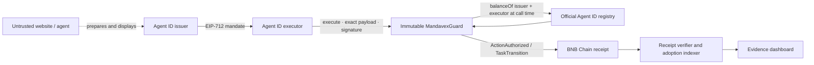

# MANDAVEX Protocol Architecture

**Status: IMPLEMENTED BUT UNVERIFIED.** The core Guard is compiled and exercised locally and on a read-only BNB mainnet-state fork. No production contract is deployed. The static website and browser Arena are demonstration software.

## Execution path

The browser and agent are outside the authorization trust boundary. The Guard validates `msg.sender`, both current Agent ID balances, EIP-712 signer, action, exact payload hash, validity interval (maximum 24 hours, exclusive expiry), issuer nonce binding, issuer revocation and use limit. Only successful validation changes state. The identity registry is queried through a typed external interface with `try/catch`; all call failures return false and execution reverts with `InvalidIdentity`.

## Mandate and state

The domain binds name `MANDAVEX`, version `1`, chain ID and verifying Guard. The signed struct is documented in [the whitepaper](docs/WHITEPAPER.md). `maxUses` is nonzero and bounds a mandate. Once a mandate succeeds, its issuer/nonce pair cannot be rebound to another mandate ID. The issuer may revoke the exact mandate ID. No privileged role, proxy or upgrade path exists.

Supported operations are a demonstration counter increment and fixed task submit/accept transitions. Task submit records owner, contributor and artifact hash; task acceptance requires the owner to authorize a distinct reviewer and repeat the exact artifact hash. There are no arbitrary calls, token operations, transfers or asset custody.

## Browser product boundaries

- The public GitHub Pages application offers Agent ID lookup, a browser-isolated Arena, Genesis pre-launch forms, Passport lookup, developer information and an evidence-backed adoption panel.
- Arena scenarios use a fresh local EVM, ephemeral demo keys and mock Agent ID; they make no BNB RPC calls and do not create adoption evidence.
- Passport queries public registry state for a shared wallet at lookup time. It is not a proof of safety or past participation.
- Local receipt summaries are persisted only in that browser's local storage. The SDK/CLI on-chain verifier is separate and requires a deployed Guard from the manifest.
- Adoption counts are unknown until a deployment and matching real-chain scan exist. Indexer candidates are not organizer qualification.
- Genesis registration is inactive until free remote D1, privacy/retention, security settings and independent persistence checks are completed.

## Toolchain and release configuration

Solidity compiler 0.8.39; optimizer 200; Paris EVM. `npm run compile:contracts` writes ABI/bytecode under the ignored `contracts/build/`. `npm run build:web` generates the Arena artifacts and evidence snapshot. `npm test` covers local EVM, bounded seeded fuzz samples, SDK/CLI, indexer and handler regression cases, plus block-pinned fork checks. `npm run test:browser` runs Playwright at desktop and mobile viewports against the local loopback application. `npm run estimate:bsc-deployment` and `npm run prepare:bsc-deployment` are read-only/unsigned preparation tools.

## Security and remaining production gates

Slither runs against the direct native solc 0.8.39 binary and currently reports the expected timestamp detector only. The 24-hour validity cap and exclusive expiry reduce exposure; they cannot remove timestamp uncertainty from block production. No independent audit is claimed. EOA-only ECDSA excludes ERC-1271 wallets. The official holder-positive fork check does not use a real holder signature and does not demonstrate a successful mainnet call. See [SECURITY.md](SECURITY.md), [ACCEPTANCE_GATES.md](ACCEPTANCE_GATES.md), and [BLOCKERS.md](BLOCKERS.md).
