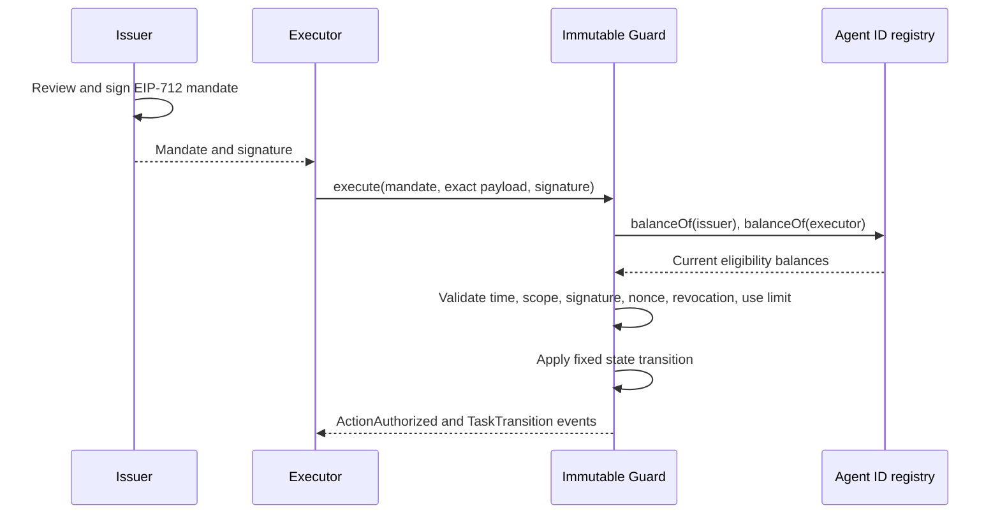

# MANDAVEX: Permission-Bound Execution for Autonomous Agents

**Technical whitepaper · competition draft · 27 November 2026**

**Evidence status: IMPLEMENTED BUT UNVERIFIED.** The repository contains an experimental immutable Solidity Guard, an isolated browser EVM demonstration, a developer SDK/CLI and a public evidence dashboard. The Guard has no mainnet deployment, independent audit, production wallet execution, or competition-qualified activity. The terms “receipt” and “execution” below refer to contract events/state on the named network; local demonstration outputs are explicitly local.

## Abstract

An agent's identity does not define what it may do. MANDAVEX explores a small execution-boundary authorization primitive: an issuer signs a typed mandate naming one executor, one supported action, one exact payload commitment, an expiry window, a nonce and a maximum use count. At execution, an immutable Guard rechecks both parties' Agent ID eligibility, validates the EIP-712 signature and scope, enforces revocation and replay limits, applies a deterministic state transition and emits an event that can be independently inspected.

The current experiment uses BNB Chain's Agent ID registry and demonstrates two narrowly defined use cases: a bounded counter action and permission-bound artifact handoff/review. The guard makes no arbitrary calls, holds no assets and exposes no administrator or upgrade function. The implementation is an engineering prototype, not a security-audited production protocol.

## Problem and design goal

Agent frameworks can route work and wallet software can sign transactions, but identity, an LLM's safety judgment, and a signed message do not by themselves enforce application-specific scope. A verifier downstream of an agent needs a deterministic answer to: who authorized this executor, which operation and data were approved, when does authority expire, can it be replayed, and what state transition actually occurred?

MANDAVEX places those checks in the contract that changes state. The frontend and agent prepare data; neither is the enforcement authority. The design deliberately favors a small, auditable operation set over general-purpose transaction forwarding.

## Components and trust boundaries

1. **Issuer** controls a wallet and signs an EIP-712 mandate. The issuer may revoke the exact mandate before it is used.
2. **Executor** submits the mandate, payload and signature. The contract requires `msg.sender` to equal the named executor.
3. **Agent ID registry** is the external eligibility source. The Guard reads `balanceOf` for both issuer and executor on every execution. A revert, malformed return or zero balance fails closed. This signal is eligibility only; it is not a safety or reputation score.
4. **MandavexGuard** stores the immutable registry address and deployment chain ID. It verifies the time window, supported action, payload hash, EOA signature, nonce binding, revocation and bounded use count before changing state.
5. **BNB Chain/RPC** provides transaction inclusion and state. An RPC response is not itself a canonical receipt; the SDK checks the receipt, target, block hash and configured chain.
6. **Browser and agent runtime** are untrusted convenience layers. The public Arena uses ephemeral fixture keys and a mock identity registry in an in-memory EVM; it sends no public-chain request or transaction.

The Guard's deterministic lifecycle is:



## Mandate and cryptographic binding

The signed struct is:

```text
Mandate(
  address issuer,
  address executor,
  bytes32 action,
  bytes32 payloadHash,
  uint64 validAfter,
  uint64 expiry,
  uint256 nonce,
  uint32 maxUses
)
```

The EIP-712 domain is `MANDAVEX`, version `1`, the deployment chain ID and the verifying Guard address. Changing the chain, Guard, actor, action, payload commitment, time window, nonce or use limit invalidates the issuer's signature. The current Guard accepts EOA ECDSA signatures, requires 65 bytes, enforces low-s form and valid recovery identifiers, and uses bounds-checked calldata slices rather than inline signature parsing assembly.

Mandates must have `validAfter < expiry`, a maximum lifetime of 24 hours and a nonzero use limit. The expiry boundary is exclusive. A successful use binds the issuer's nonce to the mandate ID; the same mandate can execute only up to its signed `maxUses`. Revocation is issuer-only and keyed to the chain- and contract-bound mandate ID. Identity is checked at the state-change boundary, not trusted from mandate creation or UI state.

## Supported transitions

The fixed action set includes a counter increment for the isolated Arena and two task workflow operations:

- **Submit:** the issuer is the task owner and the executor is the contributor. The payload contains a nonzero task ID and artifact hash. A task can be submitted once.
- **Accept:** the issuer must be the task owner; the executor must differ from the contributor; the task must still be submitted; and the artifact hash must equal the submitted hash. The contract records a distinct reviewer and marks the task accepted.

These operations demonstrate permissioned state transitions. The hash commits to bytes but does not prove the artifact's truth, quality, authorship or off-chain availability. The counter is explicitly a demonstration primitive. No user assets, tokens, arbitrary target calls or custody are supported.

## Receipts, Passport and evidence

Each successful execution emits `ActionAuthorized` with the mandate ID, issuer, executor, action, payload hash, use number and resulting counter. Task transitions also emit `TaskTransition`. The SDK's on-chain receipt verifier checks the selected chain, transaction and receipt availability, Guard target, canonical receipt block hash, success status and expected event fields. The CLI reads the configured deployment manifest before a BNB Chain lookup and refuses to query when there is no deployed Guard.

The browser Passport currently shows a live, read-only Agent ID lookup when a public address is provided. Device-local Arena receipts remain labeled as simulation evidence. The public adoption panel consumes only deployment metadata and an optional reviewed indexer report; before a deployment and matching scan it shows `BLOCKED` / `NOT RUN` with unknown counts. Indexer candidates are not automatically organizer-qualified participants.

## Threat model and residual assumptions

The design addresses unauthorized executors, non-holder identities, changed scope or payloads, invalid and malleable signatures, cross-chain/contract replay, nonce rebinding, duplicate task submission, self-review, artifact substitution, expiry and revoked authority. Deterministic tests also cover registry failure and malformed adversarial inputs.

Residual assumptions include correctness and continuity of the official registry, BNB Chain consensus, correct RPC responses, issuer key security, executor behavior and the accuracy of supplied artifact hashes. A block timestamp has bounded validator discretion; the one-day mandate lifetime limits exposure but cannot eliminate that consensus property. EOA-only signing excludes smart-contract wallets and ERC-1271. The protocol does not make semantic decisions about natural-language requests or prove off-chain work.

The latest Slither run used the installed native solc 0.8.39 compiler directly and reported only the expected timestamp-comparison detector. This is a static-analysis result, not an audit. The project still requires independent security review before deployment.

## Implementation and reproducible verification

The source targets Solidity `0.8.39`, optimizer 200, Paris EVM. `npm test` runs local EVM lifecycle/adversarial checks, deterministic seeded payload and signature fuzz samples, SDK/CLI checks, mocked indexer/Genesis checks and read-only block-pinned BNB fork probes. `npm run compile:contracts` produces the ABI and bytecode; `npm run build:web` generates the browser Arena and evidence dashboard. `npm run test:browser` uses Playwright and a loopback preview to exercise the browser EVM, task handoff, receipt explorer and mobile/desktop layout.

The fork suite has shown that the configured production registry has code, rejects a non-holder, and returns a positive Agent ID balance for one observed address at a pinned block. The positive-holder probe intentionally stops at an invalid signature: it does not impersonate that holder, prove a signed holder execution or create qualifying competition activity. Fork transactions are not mainnet activity.

## Competition fit and current limits

The project makes Agent ID an execution-time authorization condition for both issuer and executor, rather than a profile label. A deployed contract, independently verified source, live product and genuine qualifying holder interactions remain required for competition readiness. The public website is currently a static GitHub Pages preview with a local EVM Arena; the demo is not the deployed protocol. No production Guard exists and there are no qualifying participant counts to claim.

Current deployment funding evidence is an RPC estimate only and changes with network conditions. No deployer wallet or gas funds are authorized here. No mainnet transaction, paid infrastructure, token launch or domain purchase has been made. Deployment requires an independently reviewed release and the user's own exact transaction confirmation.

## References

- Binance Agent ID Hackathon announcement and rules: https://www.binance.com/en/support/announcement/detail/95f5dbe0ea674a48a739b59e046648bf
- EIP-712 typed structured data: https://eips.ethereum.org/EIPS/eip-712
- ERC-1271 contract signature validation: https://eips.ethereum.org/EIPS/eip-1271
- Binance Agentic Wallet official external-sign workflow: https://github.com/binance/binance-skills-hub/blob/main/skills/binance-web3/binance-agentic-wallet/references/external-sign.md
